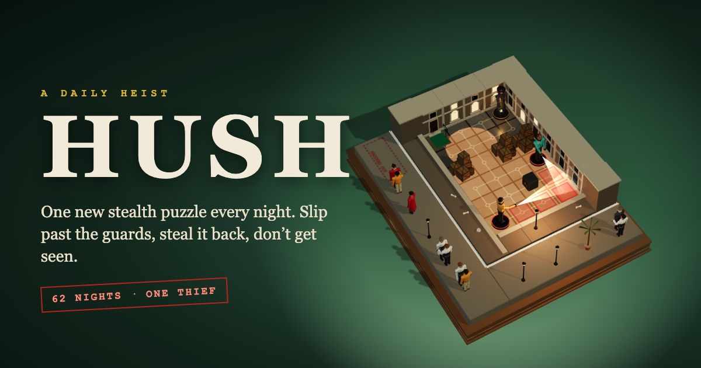
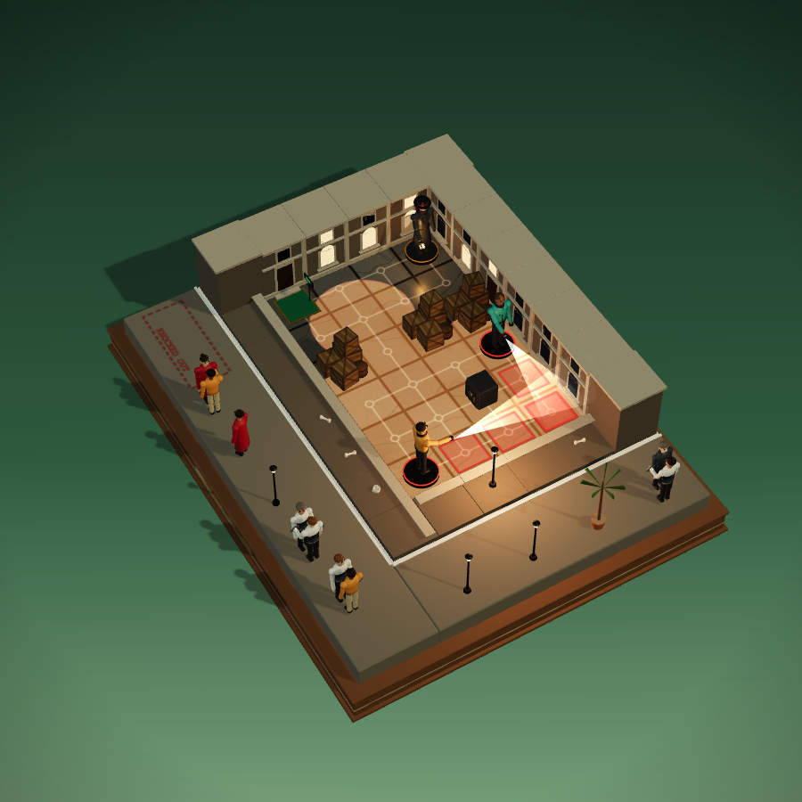
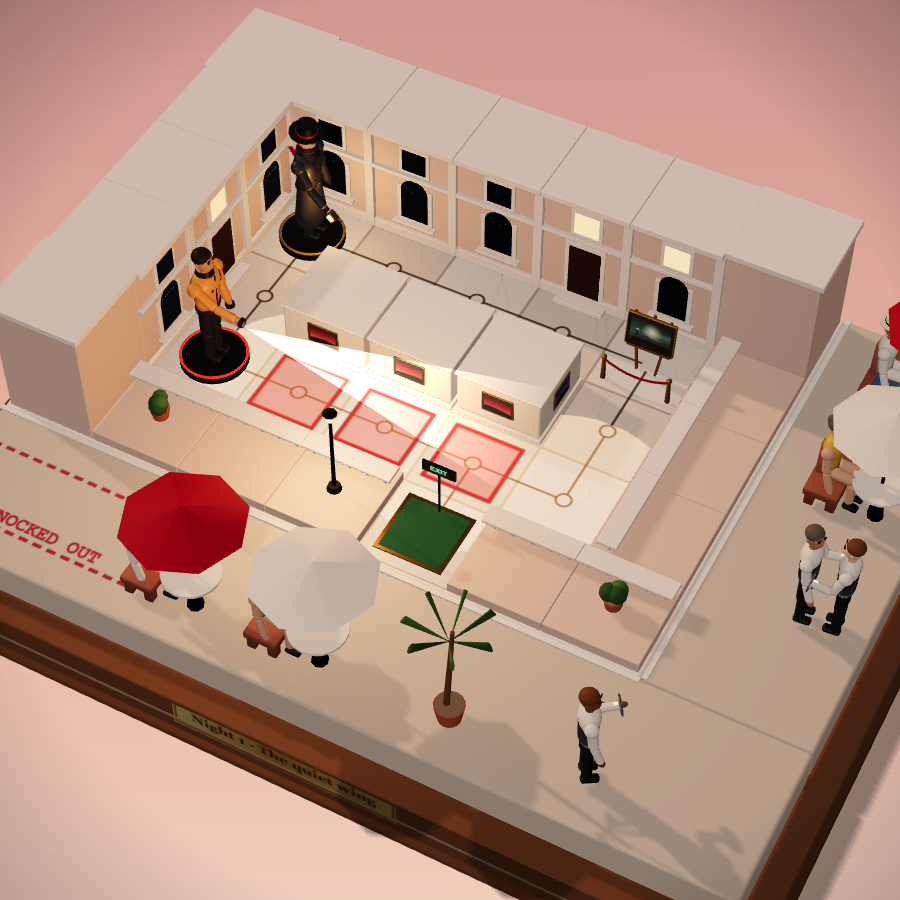
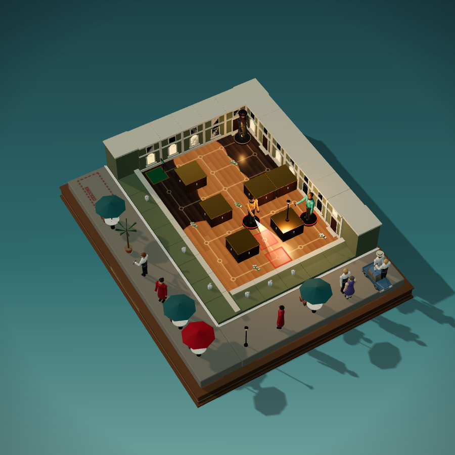
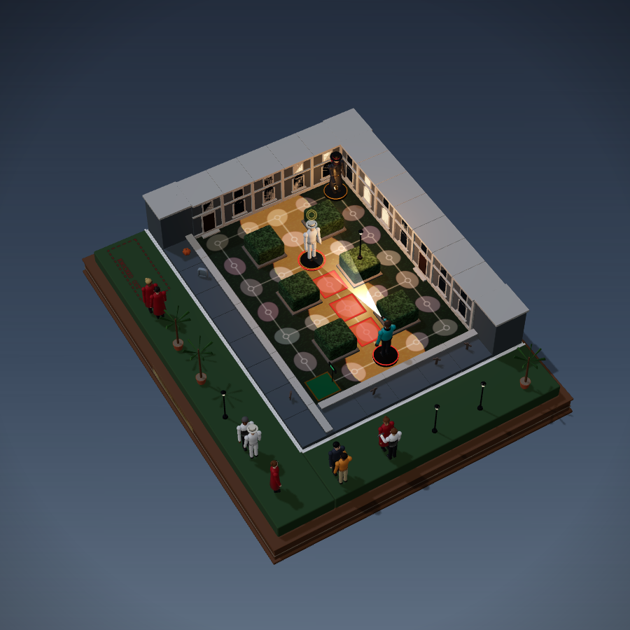

<div align="center">



# 🤫 Hush

**A daily stealth heist, played right in the Reddit feed.**
One new hand-made puzzle every night. Slip past the guards, do the job, don't get seen.


[**▶ Play on Reddit**](https://www.reddit.com/r/hush_heist_dev/) · [**App page**](https://developers.reddit.com/apps/hush-heist)

*Built for Reddit's Game of the Day Hackathon 2026*

</div>

---

## 🕵️ The story

You're **Wren**, a retired thief pulled back in by an anonymous client who calls himself **the Curator**. Every night a sealed envelope brings one job against **the Gilded Circle**, a secret ring of art thieves. Each job ends with a clue, and over 62 nights the clues lead from a Lisbon hotel room to an auction house, a family of forgers, a lonely lighthouse… and finally to the one person Wren never suspected.

## 🎲 How it plays

<table>
<tr>
<td width="50%"></td>
<td>

**Turn-based stealth on a 3D diorama.** You move one tile, then every guard moves.

- 🔦 Guards see **3 tiles ahead, but only in the light**
- 🐕 Dogs **smell 2 tiles**, light or dark
- 👊 Step onto a guard **from behind** to knock them out
- 🌴 Hide in potted palms, 🧥 wear a disguise, 🔑 find keys
- 💡 Kill the lights, 🕳️ crawl through vents, 🪙 toss a coin

</td>
</tr>
</table>

### Six kinds of job

| | Job | What you do |
|---|---|---|
| 🖼️ | **Steal a painting** | Take it off the wall and walk out |
| 💵 | **Cash run** | Grab the stacks of cash (greedy thieves take them all) |
| 🔐 | **Crack the safe** | Stand at the safe for two turns, unseen |
| 🎭 | **The swap** | Pick up the forgery first, then swap it for the real thing |
| 📁 | **Plant evidence** | Leave the file on a desk while nobody is looking |
| 🎯 | **Catch the boss** | Tag the white-suited lieutenant from behind |

### ⭐ Three stars a night

1. Finish the job and escape
2. Escape in **par** moves or fewer (every par is proven by a solver)
3. Keep the night's rule: *no takedowns*, *never step into the light*, *keep your coin*…

## 📅 Made for every day

<table>
<tr>
<td align="center" width="33%"><br/><sub>Night 1 · The quiet wing</sub></td>
<td align="center" width="33%"><br/><sub>Night 4 · Counting house</sub></td>
<td align="center" width="33%"><br/><sub>Night 12 · Boss night</sub></td>
</tr>
</table>

- **A new job at midnight UTC**, posted automatically. Everyone plays the same puzzle that day.
- **62 hand-made nights**: 14 that teach each idea, then a six-chapter story. Every building has its own theme, sky and light.
- **🔥 Streaks**, shown as community flair next to your name.
- **🏆 Nightly leaderboard**: top 10 thieves by stars, then fewest moves, plus your own rank.
- **💬 Post to comments**: one tap shares a spoiler-free result card on the night's post.
- **📺 A live feed card**: the guards patrol in the dark right in the feed, but Wren never moves, so the solution is never spoiled.

## 🧭 Built for first-time players

No wall of rules. New players get **one short tip at a time**, right on the board, only when it matters: how to move, what red tiles mean, when a guard's back is turned, when a palm can hide you. The tips stop after your first escape.

## 🛠️ Under the hood

| Part | What it does |
|---|---|
| `src/shared/sim.ts` | The whole rulebook as pure functions, plus a **BFS solver** that proves every night is winnable and sets its exact par |
| `src/shared/levels.ts` | 62 nights as tiny text maps (`#` wall, `S` start, `P` painting, `$` cash, `B` safe…) |
| `src/client/three/` | The three.js diorama: procedural figurines, batched scenery (about 360 draw calls), 10 lighting moods, drag and pinch camera |
| `src/client/game.ts` | Case-file briefing, HUD, coach tips, result card, leaderboard |
| `src/client/splash.ts` | The animated in-feed card |
| `src/server/` | Hono on Devvit: streaks, best runs, leaderboard and stats in **Redis**, a nightly **scheduler** post, flair, comments, and a mod-only **Hush stats** menu |

**Stack:** Devvit Web · TypeScript (strict) · three.js · Vite · Hono · Redis. Every sound is synthesised in code, with no audio files.

## 🚀 Run it yourself

```bash
npm install
npm run login        # log the Devvit CLI into Reddit
npm run dev          # playtest live in your test subreddit
npm run test:unit    # rules tests + solver check of all 62 nights
npm run deploy       # type-check, lint, then upload
```

### Add a night

1. Add an entry to `LEVELS` in `src/shared/levels.ts` with `par: 0`.
2. Run `npm run test:unit`. The solver reports the real par, or says the night can't be won.
3. Set `par` to that number and run the tests again.

## 🙏 Credits

Props from the **KayKit** packs by Kay Lousberg ([kaylousberg.com](https://www.kaylousberg.com)), licensed CC0. Characters, buildings and paintings are generated in code.

<div align="center"><sub>Hush. Don't get seen.</sub></div>
